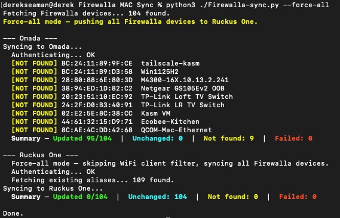

# Firewalla to Omada + Ruckus One Device Name Sync

Syncs device names from the [Firewalla](https://firewalla.com/) MSP cloud API
to network management platforms. When run, the script fetches all known devices
from Firewalla and pushes each device's name to every configured platform using
the device's MAC address as the lookup key.

Devices without a name or with an invalid MAC address are automatically skipped.
On subsequent runs, devices whose name already matches are skipped entirely
(no unnecessary API calls). Each platform syncs independently, so a problem
with one (e.g. an unreachable Omada controller) doesn't stop the others.

## Supported Platforms

| Platform | Method | Notes |
| --- | --- | --- |
| **TP-Link Omada** | REST API | Local controller access required; firmware 5.1+ |
| **Ruckus One** | REST API | Cloud-based; reachable from anywhere (see note below) |

The script is designed to make adding new platforms straightforward — see
[Adding a New Platform](#adding-a-new-platform) below.

## Blog Post

For additional information about Firewalla, Ruckus One, Omada, and this script,
see my blog post:

<!-- markdownlint-disable-next-line MD013 -->
<a href="https://www.derekseaman.com/2026/05/how-to-firewalla-to-ruckus-one-and-omada-name-sync.html" target="_blank">How to: Firewalla to Ruckus One and Omada Name Sync</a>

## How It Works

1. Reads credentials from `secrets.conf`
2. Fetches the full device list from the Firewalla MSP API
3. Filters out entries with invalid/missing MAC addresses or empty names, and
   keeps only the first entry when a MAC appears more than once (e.g. seen by
   several Firewalla boxes); conflicting names are reported as a warning
4. For each selected platform:
   - Pushes updated names and prints a per-platform summary
   - **Omada:** authenticates directly to the controller REST API, reads the
     current client names, then only pushes names that have changed
   - **Ruckus One:** fetches known WiFi client MACs and current aliases
     first, then only pushes names that have changed — devices not
     recognized by Ruckus are reported as "not found" without making
     an API call. Use `--force-all` to push every Firewalla device
     regardless of whether Ruckus has seen it before

## Requirements

- **Python 3.8+**
- **[`requests`](https://pypi.org/project/requests/)** — HTTP client (the only dependency)

```bash
pip install requests
```

No additional tools or CLI utilities are required. Both platforms are accessed
via direct REST API calls.

## Configuration

Copy `secrets.conf.example` to `secrets.conf` and fill in your values:

```bash
cp secrets.conf.example secrets.conf
chmod 600 secrets.conf
```

`secrets.conf` contains API tokens and client secrets. Restrict its
permissions to owner-only (`600`) and ensure it is listed in `.gitignore`
to prevent accidental commits.

```ini
[DEFAULT]
FIREWALLA_API_TOKEN=your_token_here
FIREWALLA_MSP_ID=your-msp-id

# Omada SDN controller — only required when using --platform omada
OMADA_URL=https://192.168.1.1:8043
OMADA_USERNAME=your_omada_username
OMADA_PASSWORD=your_omada_password
OMADA_SITE=Default
OMADA_VERIFY_SSL=true

# Ruckus One — only required when using --platform ruckus
RUCKUS_CLIENT_ID=your_client_id_here
RUCKUS_CLIENT_SECRET=your_client_secret_here
RUCKUS_TENANT_ID=your_32_char_tenant_id_here
RUCKUS_REGION=us
```

### Where to find each value

| Key | Where to find it |
| --- | --- |
| `FIREWALLA_API_TOKEN` | Firewalla MSP portal → Account → API Settings → Create Token |
| `FIREWALLA_MSP_ID` | The subdomain of your MSP portal URL. If your portal is at `https://abc-xyz123.firewalla.net`, the MSP ID is `abc-xyz123`. |
| `OMADA_URL` | The full URL of your Omada controller, including port. Software controller default: `https://<host>:8043`. Hardware controller default: `https://<host>:443`. |
| `OMADA_USERNAME` | An Omada admin account username |
| `OMADA_PASSWORD` | Password for the Omada admin account |
| `OMADA_SITE` | The site name as shown in the Omada controller UI (default: `Default`) |
| `OMADA_VERIFY_SSL` | Set to `false` only if your controller uses a self-signed certificate. `true`/`false` (also `yes`/`no`, `1`/`0`, `on`/`off`); any other value is a configuration error |
| `RUCKUS_CLIENT_ID` | Ruckus One portal → Administration → Account Management → Settings → Application Tokens |
| `RUCKUS_CLIENT_SECRET` | Same location as Client ID |
| `RUCKUS_TENANT_ID` | The 32-character hex string in the Ruckus One portal URL: `https://ruckus.cloud/{tenant_id}/t/dashboard` |
| `RUCKUS_REGION` | `us`, `eu`, or `asia` — matches the region of your Ruckus One account |

## Usage

```bash
# Sync to all configured platforms (default)
python Firewalla-sync.py

# Sync to a specific platform only
python Firewalla-sync.py --platform omada
python Firewalla-sync.py --platform ruckus

# Sync to multiple specific platforms
python Firewalla-sync.py --platform omada ruckus

# Preview what would change without pushing anything
python Firewalla-sync.py --dry-run
python Firewalla-sync.py --platform ruckus --dry-run

# Suppress per-device NOT FOUND, SKIPPED and UPDATED lines (show summaries and failures only)
python Firewalla-sync.py --quiet

# Push all Firewalla devices to Ruckus One, even if unseen by Ruckus (Ruckus only)
python Firewalla-sync.py --platform ruckus --force-all

# Preview force-all changes without pushing anything
python Firewalla-sync.py --platform ruckus --force-all --dry-run
```

### Example Output



### Summary Fields

| Field | Meaning |
| --- | --- |
| **Updated** | Name was successfully pushed to the platform |
| **Unchanged** | Name already matched — no API call was made |
| **Not found** | Device exists in Firewalla but is unknown to this platform (e.g. a wired-only device on a WiFi-only controller) |
| **Skipped** | Nothing in the name is valid on this platform (e.g. an emoji-only name on Ruckus One). Shown only when it happens; it is not a failure and does not change the exit code |
| **Failed** | Push was attempted but the platform returned an error |
| **Not attempted** | Devices left untouched because the platform stopped answering (see below). Shown only when it happens |

On every platform, each updated device is listed in green as `[UPDATED]` with its
MAC and the name that was pushed, alongside the yellow `[NOT FOUND]` and
`[SKIPPED]` lines. `--quiet` hides all three.

## Adding a New Platform

The script uses a `Platform` abstract base class so new integrations can be
added without modifying the sync engine. A minimal platform needs only
**~20 lines of code** and **4 touch points**:

### 1. Create the class

```python
class UniFiPlatform(Platform):
    """Ubiquiti UniFi controller via REST API."""

    @property
    def platform_name(self) -> str:
        return 'UniFi'

    def set_device_name(self, mac: str, name: str) -> str:
        # mac is lowercase colon-separated, name is already sanitized
        ...
        return 'updated'   # or 'not_found', 'failed', or 'unreachable' (no answer)
```

### 2. Register it

```python
# In PLATFORM_REGISTRY at the bottom of the file:
PLATFORM_REGISTRY: dict[str, type[Platform]] = {
    'omada':  OmadaPlatform,
    'ruckus': RuckusPlatform,
    'unifi':  UniFiPlatform,      # add this
}
```

### 3. Declare required config keys

```python
PLATFORM_REQUIRED_KEYS: dict[str, list[str]] = {
    'omada': [],
    'ruckus': ['RUCKUS_CLIENT_ID', ...],
    'unifi':  ['UNIFI_HOST', 'UNIFI_USERNAME', 'UNIFI_PASSWORD'],  # add this
}
```

### 4. Add keys to `secrets.conf.example`

That's it. The argparse `--platform` choices, config validation, sync loop,
dry-run support, and summary output are all handled automatically.

### Optional overrides

| Method | Default | Override when... |
| --- | --- | --- |
| `sanitize_name(name)` | Returns name unchanged | The platform has naming restrictions (e.g. no spaces, max length) |
| `fetch_known_macs()` | `None` (sync all) | You want to limit syncing to MACs the platform already knows about |
| `fetch_existing_names()` | `{}` (always push) | The platform's API lets you read current names for skip-if-unchanged. Return `None` if the names can't be read |

See the module docstring at the top of `Firewalla-sync.py` for the full
step-by-step guide.

## Platform-Specific Behavior

### Omada

- Authenticates directly to the Omada controller REST API (firmware 5.1+ required);
  no third-party CLI or tools are needed
- Login is a three-step sequence: fetch controller ID → obtain CSRF token →
  resolve site name to site ID. The session is cached for the duration of the run
- MACs are converted from colon-separated (`aa:bb:cc:dd:ee:ff`) to
  hyphen-separated (`aa-bb-cc-dd-ee-ff`) as required by the Omada API
- Leading hyphens are stripped from device names (the Omada API treats them as
  invalid), along with any space that follows them (`- Kitchen` → `Kitchen`)
- Current client names are read first and unchanged names are skipped. If the
  client list can't be read, a warning is printed and every name is pushed
- `--dry-run` logs in to the controller, so it also verifies `OMADA_URL`,
  credentials and `OMADA_SITE`. Devices missing from the controller's client
  list are previewed as `[NOT FOUND]`, as a real run would report them
- All HTTP requests have a 10-second timeout with one automatic retry on
  transient connection errors
- The script logs out of the controller when it finishes, and logs in again
  once if the controller ends the session mid-run
- Set `OMADA_VERIFY_SSL=false` when the controller uses a self-signed TLS certificate
  (common for software controllers on a LAN); doing so suppresses urllib3 warnings

### Ruckus One

- Alias names are sanitized: accented letters lose their accent (`ü` → `u`),
  spaces and tabs become hyphens, characters outside `[a-zA-Z0-9_-]` are
  stripped, consecutive hyphens are collapsed, leading/trailing hyphens and
  underscores are trimmed, max 255 characters
- A name with nothing left after sanitizing (an emoji, or a name written
  entirely in a non-Latin script) is listed as `[SKIPPED]` and not synced
- By default, only WiFi clients that have connected to a Ruckus AP are synced —
  wired-only devices and devices Ruckus has never seen are reported as "not found"
- `--force-all` skips the WiFi client MAC lookup and attempts to push every
  Firewalla device; skip-if-unchanged still applies, so already-correct aliases
  are not re-pushed
- MACs returned by Ruckus are normalized (case and `-`, `:` or `.` separators)
  before comparing with Firewalla
- Uses a persistent HTTP session with connection pooling for performance
  across many sequential API calls
- OAuth2 JWT token is cached for the duration of the run; if it's rejected
  mid-run (HTTP 401), the script re-authenticates once and retries
- `RUCKUS_REGION` must be exactly `us`, `eu`, or `asia` — any other value
  is rejected at startup with a clear error message
- `RUCKUS_TENANT_ID` must be a 32-character hexadecimal string — validated
  at startup to catch typos before any network calls are made

## Scheduling (cron)

To sync automatically every hour, add a crontab entry:

```bash
crontab -e
```

```cron
0 * * * * cd /path/to/firewalla-mac-sync && python Firewalla-sync.py --quiet >> /var/log/firewalla-sync.log 2>&1
```

`--quiet` suppresses the per-device NOT FOUND, SKIPPED and UPDATED lines that would
otherwise fill the log on every run; failures are still listed. Normal output
goes to stdout; error messages go to stderr — both are captured, in order, by
`2>&1`. A non-zero [exit code](#exit-codes) means something needs attention.

## Troubleshooting

| Symptom | Likely cause | Fix |
| --- | --- | --- |
| `Config file 'secrets.conf' not found` | File doesn't exist | `cp secrets.conf.example secrets.conf` and fill in values |
| `secrets.conf is missing a [DEFAULT] section header` | File exists but has no section header | Add `[DEFAULT]` as the very first line of `secrets.conf` |
| `FIREWALLA_MSP_ID contains invalid characters` | Wrong value copied | Use only the subdomain, e.g. `abc-xyz123` not the full URL |
| `RUCKUS_REGION 'X' is invalid` | Typo in config | Must be exactly `us`, `eu`, or `asia` |
| `RUCKUS_TENANT_ID must be a 32-character hex string` | Wrong value copied | Copy the hex string from your portal URL, not the full URL |
| `Auth redirected` | Wrong client ID or secret | Regenerate an Application Token in the Ruckus One portal |
| `No access_token in response` | Token expired or revoked | Regenerate credentials in the Ruckus One portal |
| `Ruckus One rejected the application token` | Wrong client ID, secret or tenant ID | Check the three `RUCKUS_*` values, or regenerate the Application Token |
| `Ruckus One still rejects the token after signing in again` | The token is valid but lacks permission | Check the Application Token's role in the Ruckus One portal |
| `Firewalla rejected the API token` | Wrong or revoked token | Check `FIREWALLA_API_TOKEN` in `secrets.conf` |
| `Omada: … answered …, but not as an Omada controller` | `OMADA_URL` points at a different web server or the wrong port | Check `OMADA_URL`, including the port (usually `8043`) |
| `stopped after 3 connection failures in a row` | The platform went offline during the run | Nothing is lost; the next run syncs the devices that were not attempted |
| All devices `[NOT FOUND]` on Omada | Controller unreachable or wrong site name | Verify `OMADA_URL` is reachable and `OMADA_SITE` matches a site in the controller UI |
| `Omada login failed (code …)` | Wrong username or password | Check `OMADA_USERNAME` / `OMADA_PASSWORD` in `secrets.conf` |
| `TLS certificate verification failed` on Omada | Self-signed controller certificate | Set `OMADA_VERIFY_SSL=false` in `secrets.conf` |
| `could not read Omada client names` | Controller API didn't return the client list | Sync still runs but pushes every name; check controller firmware is 5.1+ |
| `'secrets.conf' is readable by other users` | File permissions too open | `chmod 600 secrets.conf` |
| `… appears more than once in Firewalla` | Same MAC seen by several Firewalla boxes with different names | Rename the device consistently in Firewalla; the first name is used |
| `Done with errors (exit code 4)` | Some devices failed to update | See the `[FAILED]` lines and warnings above it |
| `/clients returned N clients, but none had a readable 'mac' field` | Ruckus One changed its client list format | Nothing was synced to Ruckus One; the script needs updating for the new format |
| `'secrets.conf' is not valid UTF-8 text` | The file was saved in another encoding | Re-save `secrets.conf` as UTF-8 |
| `Firewalla returned no devices …` (exit code 3) | The Firewalla API answered with an empty device list | Check `FIREWALLA_API_TOKEN` and `FIREWALLA_MSP_ID`, and that the MSP account has boxes online |

## Notes

- ANSI color output is automatically disabled when stdout is not a TTY
  (e.g. piped to a file, running in cron) or when `NO_COLOR` is set
- Error messages are written to stderr; normal progress output goes to stdout
- `secrets.conf` values are read literally (a `%` in a password is fine), and
  a warning is printed if the file is readable by other users
- The Firewalla MSP ID is validated to contain only letters, numbers, and
  hyphens before being used in URL construction
- Line breaks, tabs and other control characters inside a Firewalla device
  name are replaced by a single space before the name is used
- `secrets.conf` is read as UTF-8, whatever the system locale
- Output that the terminal or log encoding can't represent (e.g. an emoji in
  a device name under a non-UTF-8 locale) is written as an escape such as
  `\U0001f4fa` instead of stopping the run
- Devices without a name in Firewalla are silently skipped (no empty names
  are pushed)
- All HTTP requests have a 10-second timeout with one automatic retry on
  transient connection errors. A `429`, `502`, `503` or `504` reply is retried
  up to twice, waiting as long as the server asks (`Retry-After`, capped at
  30 seconds) or 2 then 4 seconds
- If a platform fails to answer for three devices in a row, the script stops
  syncing that platform, reports the rest as "Not attempted" and exits with
  code `3`, rather than waiting out a timeout for every remaining device
- Firewalla entries that can't be used (no name, invalid MAC, unexpected
  format) are counted on an `Ignored … Firewalla entries` line. VPN peers,
  which have no MAC, are counted here; `--quiet` hides the line
- An authentication or API error stops only the affected platform; the
  remaining platforms still sync, and the exit code reports the error

### Exit codes

| Code | Meaning |
| --- | --- |
| `0` | Success |
| `1` | Configuration error (missing or invalid config value) |
| `2` | Authentication failure |
| `3` | Network or API error |
| `4` | Sync ran, but one or more devices failed to update |
| `5` | Unexpected internal error (a traceback is printed) |

When several platforms have problems, a configuration, authentication, API or
internal error takes precedence over `4`; otherwise the first error is reported.

## Linting

This project uses [ruff](https://docs.astral.sh/ruff/) for Python and
[markdownlint-cli2](https://github.com/DavidAnson/markdownlint-cli2) for
Markdown:

```bash
pip install ruff
ruff check Firewalla-sync.py
markdownlint-cli2 "*.md"
```

Configuration is in `pyproject.toml` and `.markdownlint-cli2.yaml`.
